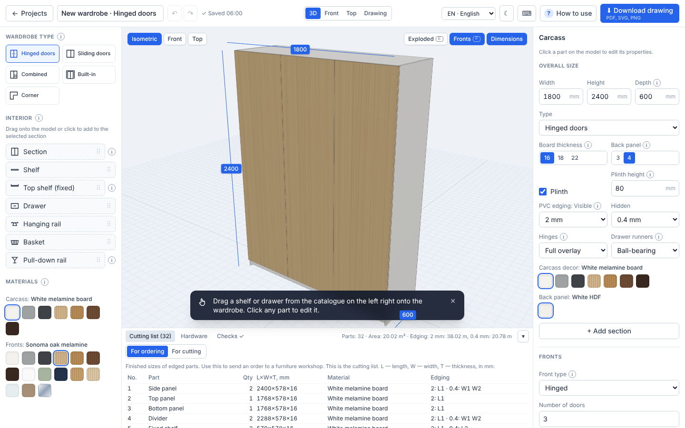
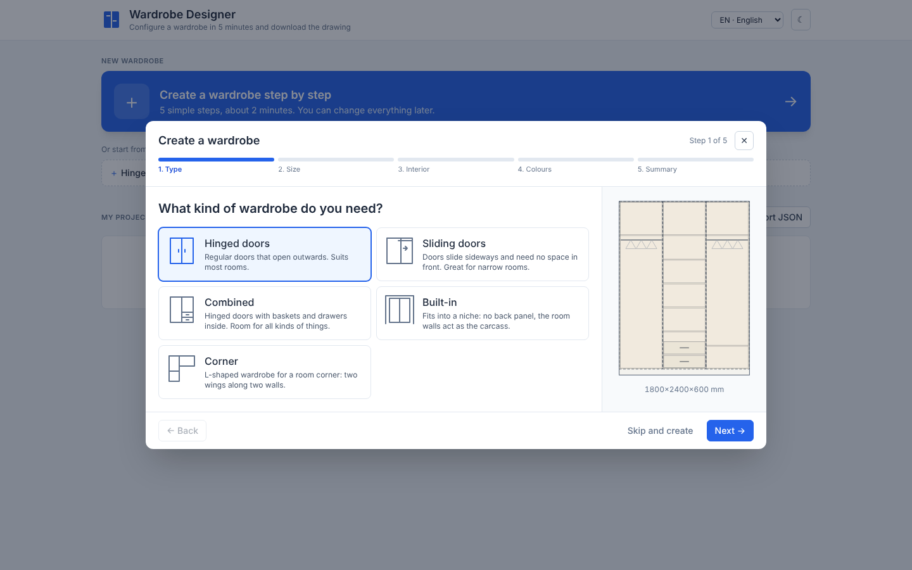
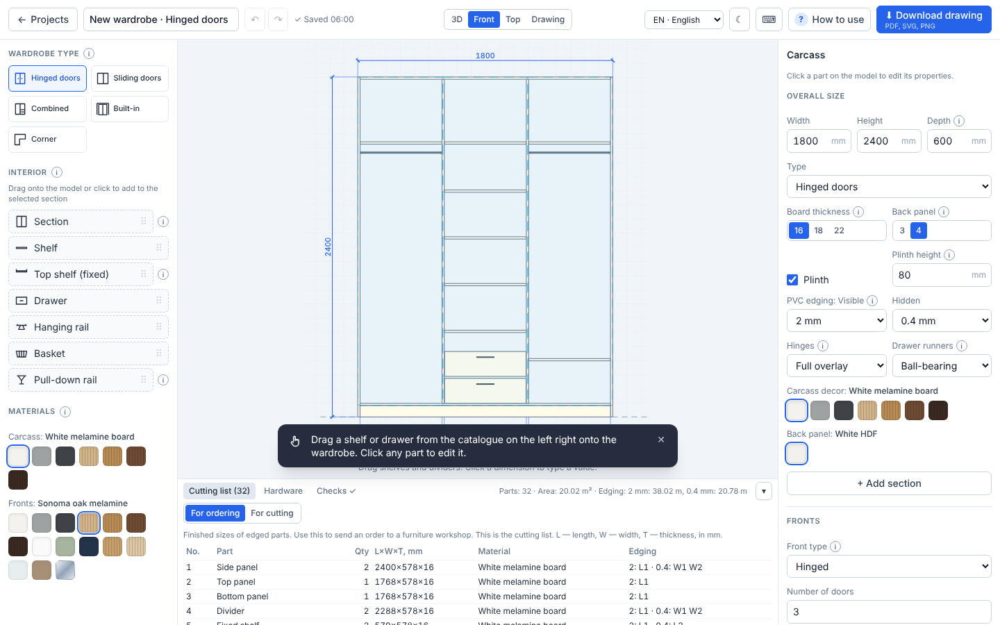
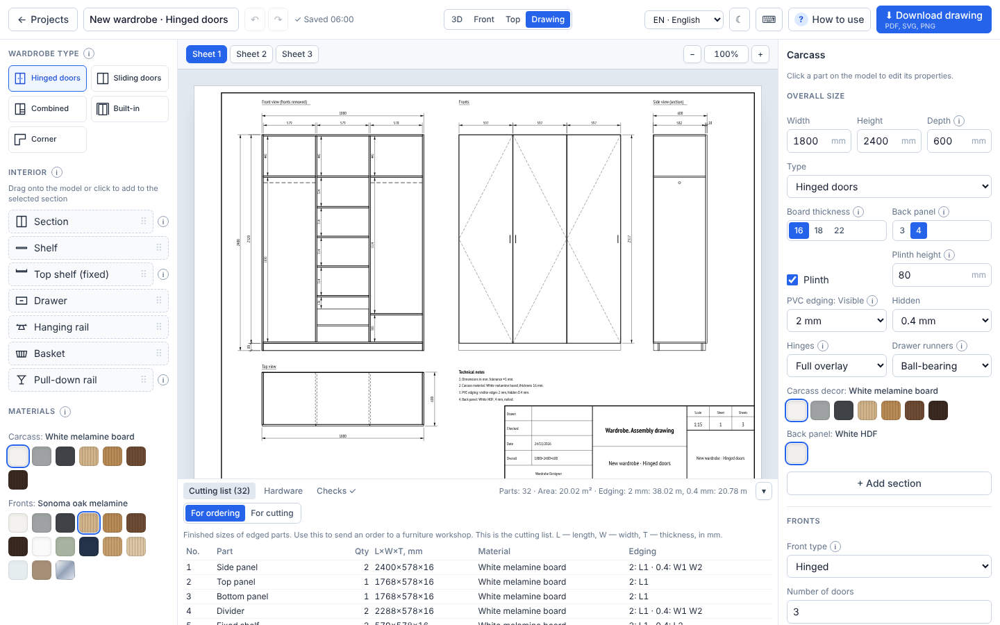
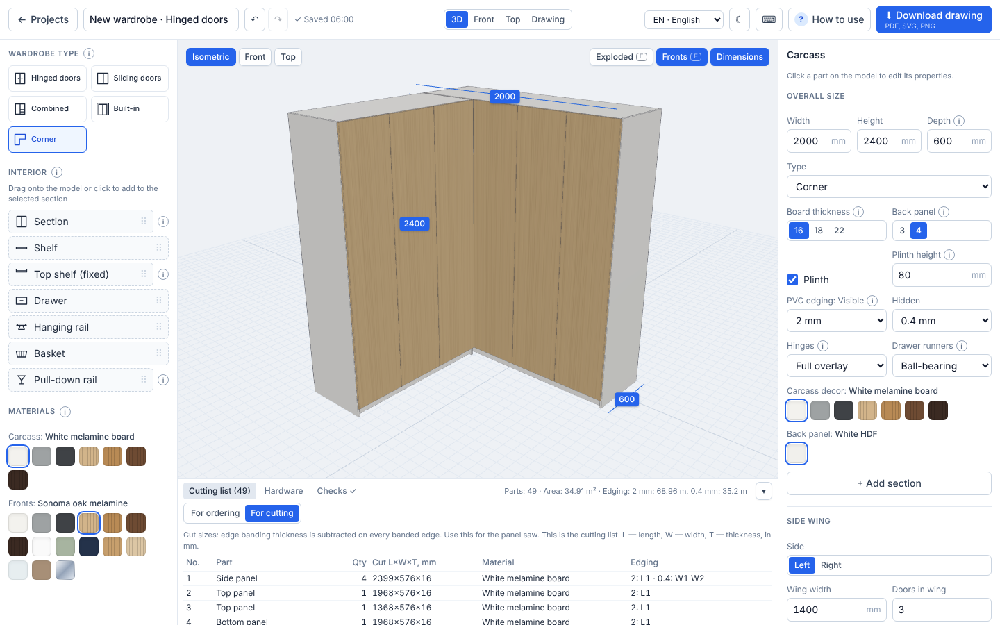

# Wardrobe Designer

[](https://github.com/ACOG1986/3D-/actions/workflows/ci.yml)


[](LICENSE)

A browser-based wardrobe configurator. Design a wardrobe in 5–10 minutes, see it in 3D and 2D,
and download a dimensioned technical drawing with a cutting list, hardware list and cutting layout.

Made for furniture makers, interior designers and home owners. A step-by-step wizard and
in-app hints explain every term, so no prior furniture knowledge is needed.

The interface and the drawings are available in **English, Lithuanian and Russian**.

> Русская версия: [docs/README.ru.md](docs/README.ru.md)



| Step-by-step wizard                      | Front view editor                                  |
| ---------------------------------------- | -------------------------------------------------- |
|    |  |
| **Technical drawing (A3)**               | **Corner (L-shaped) wardrobe**                     |
|  |  |

## Features

- **Wardrobe types:** hinged doors, sliding doors, combined, built-in, and corner (L-shaped, side wing on the left or right).
- **Carcass:** overall size, 16/18/22 mm boards, 3/4 mm HDF back panel, plinth or legs, PVC edging (0.4/2 mm), hinge and runner type.
- **Interior:** sections (dividers), adjustable and fixed shelves, drawers (roller, ball-bearing, concealed), hanging rails, baskets, pull-down rails.
- **Fronts:** hinged, sliding (2/3 doors), lift-up or none. Materials are melamine, MDF, veneer, glass or mirror. Each door can have its own decor, and the gaps are adjustable.
- **Editing:**
  - drag & drop from the catalogue onto the 3D or 2D view;
  - drag shelves and dividers with a 10 mm snap;
  - click any dimension to type a value;
  - undo/redo and autosave.
- **3D view:**
  - realistic materials (procedural wood grain, glass, mirror) and soft shadows;
  - camera presets and exploded view;
  - "hide fronts" mode;
  - overall size you can edit on the model.
- **Technical drawing:** A3 sheets with a frame and title block (simplified GOST 2.104/2.301).
  - Assembly sheet with front, fronts, side section and top/plan views, all dimensioned.
  - Cutting list and hardware list.
  - Cutting layout: melamine 2750×1830, HDF 2800×2070, guillotine packing.
  - Extra sheet for the side wing of a corner wardrobe.
- **Two cutting-list modes:**
  - _For ordering_ shows the finished sizes, the ones to send to a workshop.
  - _For cutting_ subtracts the edge banding thickness on every banded edge, for a panel saw.
  - The cutting layout always uses cut sizes.
- **Export:** PDF (all sheets, embedded font), SVG and PNG per sheet, JSON project file.
- **Validation:**
  - sizes out of range and overlapping items;
  - shelves longer than 900 mm without support;
  - overloaded hinges or runners;
  - corner wing too short.
- **For beginners:** a 5-step wizard, a guided tour, plain-language help tips and a friendly "everything is OK" check screen.
- **UX:** three-panel layout, dark/light theme, keyboard shortcuts (`?`), focus styles and ARIA labels, tablet view with slide-out panels.

## Quick start

Requirements: Node.js 18.18+ (20 recommended, see `.nvmrc`).

```bash
npm install
npm run dev        # http://localhost:5173
```

| Script                            | Purpose                                                |
| --------------------------------- | ------------------------------------------------------ |
| `npm run dev`                     | Start the dev server                                   |
| `npm run build`                   | Type-check and build for production into `dist/`       |
| `npm run preview`                 | Serve the production build locally                     |
| `npm test`                        | Run unit tests (Vitest)                                |
| `npm run lint`                    | ESLint (zero warnings allowed)                         |
| `npm run format` / `format:check` | Prettier                                               |
| `npm run typecheck`               | TypeScript strict check                                |
| `npm run check`                   | All of the above except build, the same checks CI runs |

The app is fully client-side. Projects are stored in the browser's `localStorage`, and you can export or import them as JSON.
`dist/` is a static site and can be hosted on any static hosting (GitHub Pages, Netlify, S3…).

### Keyboard shortcuts

| Keys                                 | Action                          |
| ------------------------------------ | ------------------------------- |
| `Ctrl+Z` / `Ctrl+Y` (`Ctrl+Shift+Z`) | Undo / redo                     |
| `Delete`                             | Delete selected item            |
| `Ctrl+D`                             | Duplicate selected item         |
| `↑` / `↓` (`Shift` ×10)              | Move selected item by 10 mm     |
| `1` `2` `3` `4`                      | 3D / Front / Top / Drawing view |
| `E`, `F`                             | Exploded view, show/hide fronts |
| `Esc`, `?`                           | Clear selection, show shortcuts |

## Tech stack

React 18 · TypeScript (strict) · Vite · Tailwind CSS · Zustand · three.js with `@react-three/fiber` and `@react-three/drei` ·
jsPDF with `svg2pdf.js` · Vitest · ESLint · Prettier · GitHub Actions.

## Project structure

```
src/
  types/wardrobe.ts       Data model: Wardrobe, Section, SectionItem, Door, Panel, SpecRow…
  lib/
    geometry.ts           Parts, doors, cutting list, hardware, cutting layout, validation (pure functions)
    drawing.ts            Builds the SVG drawing sheets from the model
    export.ts             PDF / SVG / PNG / JSON export
    materials.ts          Material and decor catalogue (localised names)
    projects.ts           Project storage in localStorage, JSON import/export
    *.test.ts             Unit tests
  i18n/                   ru / lt / en dictionaries (keys are checked by the compiler)
  store/wardrobeStore.ts  Zustand store: model, undo/redo history, UI state, autosave
  components/
    viewer3d/             Scene, WardrobeMesh, CameraRig, DimensionLabels
    drawing2d/            FrontEditor, TopEditor (interactive), DrawingView (sheets)
    panels/               TopBar, LeftPanel (catalogue), RightPanel (properties), BottomPanel (lists)
    controls/             DimensionInput, Select/Segmented, MaterialPicker
    onboarding/           Wizard, Tour, HelpTip
  pages/                  Projects, Editor
public/fonts/             PT Sans Narrow (SIL OFL) used in drawings and PDF
```

## Architecture

A single JSON object, `Wardrobe`, is the source of truth. Pure functions in `lib/geometry.ts` derive everything else from it: 3D parts, 2D views, the drawing, the cutting list and the hardware list. Any change updates every view at once, and the calculations can be unit-tested without a browser.

```ts
type Wardrobe = {
  id: string;
  name: string;
  type: 'swing' | 'sliding' | 'corner' | 'built-in' | 'combined';
  width: number;
  height: number;
  depth: number; // mm, overall size
  boardThickness: 16 | 18 | 22;
  backThickness: 3 | 4;
  bodyMaterial: MaterialId;
  backMaterial: MaterialId;
  edge: { visible: 0 | 0.4 | 2; hidden: 0 | 0.4 | 2 };
  plinth: { enabled: boolean; height: number };
  hinge: 'overlay' | 'half-overlay' | 'inset';
  defaultSlide: 'roller' | 'ball' | 'tandem';
  doors: {
    kind: 'swing' | 'sliding' | 'lift' | 'none';
    count: number;
    material: MaterialId;
    overrides: (MaterialId | null)[]; // per-door decor
    gap: number;
    handle: 'bar' | 'knob' | 'push';
  };
  sections: Section[]; // left to right
  corner?: { side: 'left' | 'right'; width: number; sections: Section[]; doorCount: number };
  hardware: HardwareItem[]; // extra manual hardware
  createdAt: number;
  updatedAt: number;
};

type Section = { id: string; width: number /* clear width */; items: SectionItem[] };

type SectionItem = // y = height above the bottom panel, mm

    | { kind: 'shelf'; id: string; y: number; fixed?: boolean }
    | { kind: 'drawer'; id: string; y: number; height: number; slide: SlideType }
    | { kind: 'rod'; id: string; y: number }
    | { kind: 'basket'; id: string; y: number; height: number }
    | { kind: 'pantograph'; id: string; y: number };
```

Coordinates: `x` runs left to right, `y` from the floor up, and `z` from the back panel to the fronts.

### Construction assumptions

- Side panels run full height. The top and bottom panels sit between them. The plinth has a front strip set back 30 mm and a rear strip.
- The HDF back panel is nailed on and measures `W − 4 × (H − plinth) − 4`.
- **Overlay hinged doors:**
  - carcass depth = `D − t − 2`;
  - door width = `W / n − gap`;
  - hinges per door by height: up to 900 mm → 2, up to 1600 → 3, up to 2000 → 4, up to 2400 → 5, taller → 6.
- **Sliding doors:** 100 mm track zone, 30 mm overlap between doors, door height = opening − 40 mm.
- **Corner (L-shaped) wardrobe:**
  - two carcasses; the side wing's back is against the side wall and its end panel butts against the main wing's fronts;
  - the main wing's doors start after the corner zone (width = wardrobe depth);
  - the two wings are joined with connector bolts.
- **Cut sizes:** finished size minus the edge banding thickness. Banding on the long edges (L1, L2) reduces the width; banding on the short edges (W1, W2) reduces the length.

## Roadmap

- [ ] **Production accuracy:** inset/half-overlay door geometry, sliding-door frame profiles, drilling map, inner-drawer clearance checks.
- [ ] **Pricing:** material and hardware price lists, cost estimate, quote PDF.
- [ ] **Backend:** Node.js (Fastify) with PostgreSQL for projects, S3 for exports, accounts, public read-only links.
- [ ] **Hardware catalogues:** Blum/Hettich article numbers.
- [ ] **Integration:** 1C/CRM order export.
- [ ] **More shapes:** U-shaped and trapezoid corner units, several carcasses per project.
- [ ] **Better cut optimisation:** offcut reuse, grain-aware rotation rules, export to panel-saw software (CSV).
- [ ] **Drawing:** more sheet sizes (A4–A1), GOST type A font, section details.
- [ ] **Quality:** end-to-end tests (Playwright) in CI, performance budget for 500+ parts.

See [CHANGELOG.md](CHANGELOG.md) for released changes.

## Contributing

Contributions are welcome. Please read [CONTRIBUTING.md](CONTRIBUTING.md) first.

## License

[MIT](LICENSE). The PT Sans Narrow font is © ParaType and licensed under the [SIL Open Font License 1.1](public/fonts/OFL.txt).
